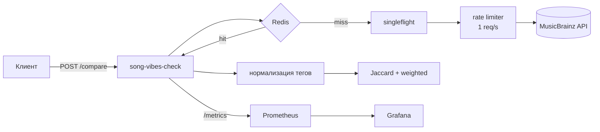

<div align="center">

# 🎧 song-vibes-check

**Микросервис на Go, который сравнивает две песни по жанровым тегам MusicBrainz и объясняет, почему они похожи (или нет).**

[](https://github.com/mindcapp/song-vibes-check/actions)


[Как это работает](#-как-это-работает) •
[Быстрый старт](#-быстрый-старт) •
[API](#-api) •
[Конфигурация](#%EF%B8%8F-конфигурация) •
[Мониторинг](#-мониторинг) •
[Деплой](#-деплой) •
[Ограничения](#%EF%B8%8F-ограничения)

</div>

---

## ✨ Возможности

- **Два счёта схожести:** классический Jaccard по множествам тегов и взвешенный — по долям голосов MusicBrainz.
- **Объяснимый ответ:** общие теги, теги только одной из песен, источник тегов и флаг `low_data`, если данных мало.
- **Нормализация тегов:** регистр, синонимы (`hip-hop` = `hip hop` = `hiphop`), стоп-лист мусорных тегов (`seen live`, годы, национальности).
- **Стабильный результат:** теги собираются из всех тегированных записей, а не из случайной страницы выдачи; счёт детерминирован.
- **Redis-кэш с деградацией:** без Redis сервис продолжает работать, просто медленнее; одинаковые параллельные запросы склеиваются (singleflight).
- **Бережное отношение к MusicBrainz:** лимит 1 запрос/с, один повтор при `503` с учётом `Retry-After`, корректный `User-Agent`.
- **Наблюдаемость:** структурные JSON-логи (`log/slog`), метрики Prometheus, готовый дашборд Grafana.

## 🧠 Как это работает



1. Для каждой песни ищется запись в MusicBrainz и собираются теги всех её тегированных версий.
2. Если пригодных тегов меньше трёх, добавляются теги исполнителя (lookup по MBID) с весом 0,5.
3. Теги нормализуются, мусор отбрасывается.
4. Считаются `genre_score` (Jaccard) и `weighted_score` (weighted Jaccard по долям голосов внутри трека).

## 🚀 Быстрый старт

**Требования:** Docker и Docker Compose.

```bash
git clone https://github.com/mindcapp/song-vibes-check.git
cd song-vibes-check

cp .env.example .env
echo "USER_SERVICE_SECRET_KEY=$(openssl rand -hex 32)" >> .env

docker compose up --build -d
```

| Сервис     | Адрес                          |
| ---------- | ------------------------------ |
| API        | http://127.0.0.1:8080          |
| Prometheus | http://127.0.0.1:9090          |
| Grafana    | http://127.0.0.1:3000          |

Все порты привязаны к `127.0.0.1` и наружу не публикуются.

> mood-service тяжёлый (PyTorch) и требует ключ Genius API, поэтому запускается только по запросу:
> `GENIUS_API_KEY=... docker compose --profile mood up --build`

**Без Docker:**

```bash
go run ./cmd/server
```

Без `REDIS_URL` сервис работает без кэша.

## 📡 API

| Метод | Путь       | Назначение                         |
| ----- | ---------- | ---------------------------------- |
| POST  | `/compare` | сравнение двух песен               |
| GET   | `/health`  | health check, `{"status":"ok"}`    |
| GET   | `/metrics` | метрики в формате Prometheus       |

### Пример запроса

```bash
curl -s -X POST localhost:8080/compare \
  -H 'Content-Type: application/json' \
  -d '{
    "song_a": {"artist": "Queen", "title": "Bohemian Rhapsody"},
    "song_b": {"artist": "Guns N Roses", "title": "Sweet Child O Mine"}
  }' | jq
```

### Пример ответа

```json
{
  "genre_score": 0.1698,
  "weighted_score": 0.2989,
  "shared_tags": ["rock", "hard rock", "classic rock"],
  "only_a": ["progressive rock", "art rock", "opera"],
  "only_b": ["heavy metal", "glam metal"],
  "tags_a": ["..."],
  "tags_b": ["..."],
  "tag_source_a": "recording",
  "tag_source_b": "recording",
  "low_data": false
}
```

<sub>Списки тегов сокращены для примера.</sub>

| Поле | Что значит |
| --- | --- |
| `genre_score` | Jaccard по нормализованным тегам, от 0 до 1 |
| `weighted_score` | взвешенная схожесть по долям голосов за теги |
| `shared_tags` / `only_a` / `only_b` | что совпало и что есть только у одной песни |
| `tags_a` / `tags_b` | сырые теги из MusicBrainz, без нормализации |
| `tag_source_a` / `tag_source_b` | `recording`, `mixed` (записи + исполнитель) или `artist` |
| `low_data` | `true`, если у одной из песен меньше трёх тегов — счёт ненадёжен |

### Коды ответов

| Код | Когда |
| --- | --- |
| `200` | всё хорошо |
| `400` | невалидный JSON или пустые поля |
| `404` | песня не найдена в MusicBrainz |
| `422` | песня найдена, но у неё нет тегов |
| `502` | MusicBrainz недоступен; приходит заголовок `Retry-After` |
| `500` | внутренняя ошибка (паника перехватывается и пишется в лог со стеком) |

## ⚙️ Конфигурация

| Переменная | По умолчанию | Назначение |
| --- | --- | --- |
| `MB_USER_AGENT` | `song-vibes-check/0.2.0 ( https://github.com/mindcapp/song-vibes-check )` | User-Agent для MusicBrainz, по правилам API нужен контакт |
| `REDIS_URL` | — | адрес Redis; без него кэш выключен |
| `CACHE_TTL` | `24h` | время жизни трека в кэше |
| `CACHE_LOW_DATA_TTL` | `1h` | для треков с малым числом тегов |
| `CACHE_NEGATIVE_TTL` | `10m` | для «не найдено» и «нет тегов» |
| `CACHE_ARTIST_TTL` | `72h` | для тегов исполнителя |
| `REQUEST_TIMEOUT` | `30s` | общий таймаут обработки запроса |
| `TAG_STOPLIST_FILE` | встроенный | свой стоп-лист тегов |

Ошибки MusicBrainz в кэш не попадают.

## 📈 Мониторинг

Дашборд Grafana подключается автоматически через provisioning.

| Метрика | Описание |
| --- | --- |
| `http_requests_total{method,path,status}` | запросы к сервису |
| `http_request_duration_seconds{method,path}` | время обработки |
| `musicbrainz_request_duration_seconds` | время запросов к MusicBrainz |
| `musicbrainz_errors_total{reason}` | ошибки MusicBrainz по причинам |
| `cache_hits_total{cache}` | попадания в кэш (`track` / `artist`) |
| `cache_misses_total{cache}` | промахи, только лидер singleflight |
| `cache_coalesced_total{cache}` | запросы, склеенные с уже идущим |

Неизвестные пути сводятся к `other`, чтобы сканеры не раздували число рядов.

## 🧪 Тесты

```bash
go test -race ./...
```

Тесты не ходят в живой MusicBrainz: клиент проверяется на `httptest`-сервере и записанной фикстуре ответа. Для ручной проверки на живых данных есть `scripts/smoke.sh`.

## 📦 Деплой

Прод — бинарь под systemd на VPS, за nginx с TLS. GitHub Actions:

1. на каждый pull request — `gofmt`, `go vet`, `go test -race`;
2. на push в `main` — сборка, копирование бинаря на VPS, перезапуск сервиса и health-check. Если health-check не прошёл, джоба падает.

Пошаговая первичная настройка сервера (пользователь, systemd-юнит, sudoers, nginx и certbot) — в [`deploy/`](deploy/).

## ⚠️ Ограничения

- **Данные MusicBrainz краудсорсные.** Теги и голоса меняются, у малоизвестных треков их может не быть совсем.
- **Холодный запрос занимает несколько секунд** из-за лимита 1 запрос/с и возможного повтора при `503`. Повторный — миллисекунды из кэша.
- **Стабильность опирается на фильтр `tag:*`** в поиске MusicBrainz — это поведение поисковика, а не гарантия API.
- **Составные теги не пересекаются с простыми:** `british rock` и `rock` считаются разными.

## 🗺 Roadmap

- [x] Нормализация тегов и взвешенная схожесть
- [x] Redis-кэш, singleflight, деградация без Redis
- [x] Метрики MusicBrainz и дашборд Grafana
- [ ] Проверка веток `mixed` и `artist` на живых данных
- [ ] Redis на VPS
- [ ] Связка с mood-service для сравнения по настроению текста

## 🛠 Стек

**Go 1.26** · `net/http` · `log/slog` · **Redis** (`go-redis/v9`) · **Prometheus** · **Grafana** · **Docker Compose** · **GitHub Actions** · systemd · nginx

---

<div align="center">
<sub>Сделано <a href="https://github.com/mindcapp">mindcapp</a> · данные: <a href="https://musicbrainz.org">MusicBrainz</a> (CC0)</sub>
</div>
